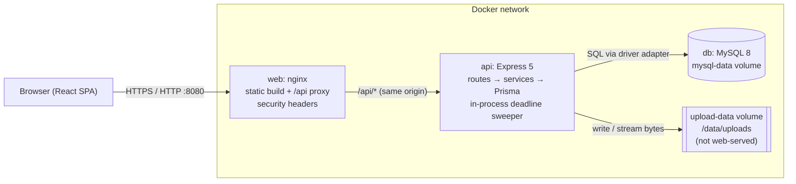
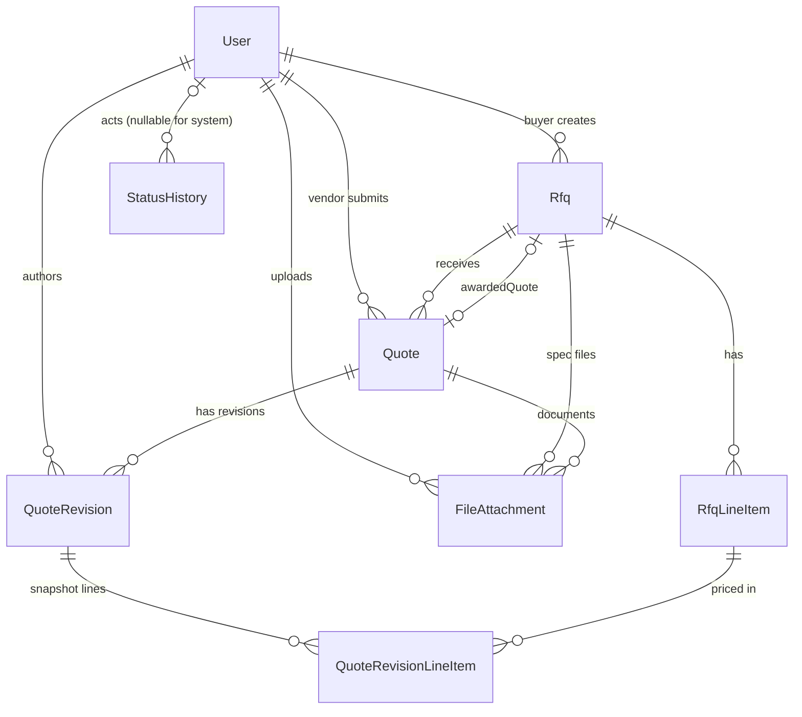

# Mini RFQ Portal: System Design

This document covers the ten sections required by the assignment. It describes the code as it is built. Where the build differs from the first plan, the difference is noted in §2 and §10.

Stack: **React + Vite + TypeScript** (frontend), **Node.js + Express 5 + TypeScript** (backend), **MySQL 8** with **Prisma** (data), **Docker Compose** (one-command run).

---

## 1. Requirement understanding

**Problem.** A buyer company publishes a Request for Quotation (RFQ) with line items and a deadline. Vendors browse open RFQs, submit a priced quotation, and may revise it until the deadline. After the deadline nothing can change. The buyer compares the quotations side by side and awards one vendor. The awarded quotation becomes *Accepted*, the others become *Rejected*, and the RFQ becomes *Awarded*. Admins manage accounts and can see everything.

**Lifecycles.**
- RFQ: `DRAFT → PUBLISHED → CLOSED → AWARDED`. `PUBLISHED → CLOSED` happens automatically when the deadline passes.
- Quotation: `SUBMITTED → SHORTLISTED → ACCEPTED | REJECTED`. Shortlisting is a buyer action after closure. Accepted and Rejected are set only by the award.

**User flows by role.**

| Role | Main flows |
|---|---|
| Buyer | Register → create RFQ with line items and a deadline (IST) → save draft or publish → attach PDF/XLSX specs → edit within the publication rules → after closure, compare sorted by total or delivery time → shortlist → award one quotation (confirmation required) → view status history |
| Vendor | Register → search open RFQs by keyword, category, location and deadline (paginated) → open RFQ → submit one quotation with a unit price per line item, delivery days and notes → revise before the deadline → attach PDF/XLSX pricing documents → view own revisions and status |
| Admin | List and filter users, change roles, enable/disable accounts → list all RFQs and quotations → open any RFQ, comparison, quotation or status history |

**In scope.** Everything in the assignment's "must have" list: auth and roles, RFQ management, quotation submission and revision, comparison, atomic award, status history, PDF/XLSX upload and download, search and pagination, the required screens, MySQL with migrations, tests, Docker and a single run command. Also a seed script and OpenAPI documentation.

**Out of scope (deliberately).** Multi-currency and tax handling, email notifications, password reset and email verification, the optional general audit log (only the status history is implemented), file malware scanning, SSO, mobile apps, and multi-tenant organisations.

---

## 2. Assumptions and open questions

Each entry is a decision made where the brief was open, with its reason. All are applied consistently in code and tests.

| # | Assumption | Reason |
|---|---|---|
| A1 | **Vendors cannot see other vendors' quotations, prices or documents.** The vendor RFQ view shows only that vendor's own quotation status and total. | Protects competitive pricing. Enforced in the service layer and tested. |
| A2 | **Revisions are append-only.** Each save inserts a `QuoteRevision` with its own line-item snapshot and total. Old revisions are never edited. Comparison and award use the latest revision. | Keeps an audit trail of what was offered and when, and keeps award decisions tied to a fixed price. |
| A3 | **Another vendor's quotation returns 404, not 403.** Same for RFQs owned by another buyer. | Hides whether a record exists. Reduces enumeration. |
| A4 | **Deadline semantics:** an RFQ is open while `now < deadline` and closed once `now >= deadline`. Deadlines are stored as UTC instants. The UI enters and shows them in IST (+05:30). | Gives one unambiguous boundary. India has no DST, so a fixed offset is safe. |
| A5 | **Buyers see quotations only after the RFQ closes.** Admins can see them at any time. | Stops buyers from negotiating on partial information before the deadline. |
| A6 | **Editing a published RFQ:** only `description`, `budget` and `deadline` can change, and the deadline can only be extended. Title, category, delivery location and line items are locked. | Vendors have already priced those fields. Changing them would make existing quotations misleading. |
| A7 | **Draft RFQs are fully editable,** including line items. | No quotations exist yet, so nothing can become inconsistent. |
| A8 | **Quotation status is `SUBMITTED` until the award or shortlisting.** A quotation can be revised only while it is `SUBMITTED` and before the deadline. | Keeps the state machine small and matches the brief's statuses. |
| A9 | **Money:** INR only. Stored as `DECIMAL(16,2)`. Unit prices are positive, up to ₹99,999,999.99. Quantities are whole numbers from 1 to 100,000. Totals are computed on the server using decimal arithmetic (decimal.js via Prisma.Decimal). The browser's total is a labelled preview. | Avoids binary floating-point error. Limits keep every line total inside the column size. |
| A10 | **Admin accounts** are created through `POST /auth/register` with `role: "ADMIN"` and a matching `ADMIN_INVITE_CODE`. The code is compared in constant time. If the code is unset, admin self-registration is disabled. | Lets an operator provision admins without a manual database edit. Nobody can elevate themselves through the public form. |
| A11 | **Admins cannot demote or disable their own account.** A role cannot change while the user still owns RFQs or quotations. | Prevents lock-out of the last admin and keeps historical records consistent. |
| A12 | **Deadline closure** happens in three places: on every request that depends on RFQ state, in a background sweep (default every 60 seconds), and in the transaction that accepts a quotation. The closure uses a conditional `UPDATE`, so it is safe to run concurrently. | Closure cannot depend on someone opening the page. Conditional updates make repeated runs harmless. |
| A13 | **Ties in the comparison** are broken by submission time, then vendor name, then quotation id. | Gives the same order on every request, which is what "stable sorting" requires. |
| A14 | **Attachment limits:** 10 specification files per RFQ, 5 documents per quotation, 10 MB per file (configurable through `MAX_UPLOAD_MB`). Specs can be added only while the RFQ is Draft or Published. Quotation documents only before the deadline. | Bounds storage and keeps the record stable. |
| A15 | **Status history** is written in the same transaction as each status change. Revisions are not status changes, so they are recorded as `QuoteRevision` rows instead. Automatic closures have no actor (`actorId = null`). | History and state cannot disagree. Revisions already have their own immutable records. |
| A16 | **A quotation requires a price for every RFQ line item,** and each price must refer to a line item on that RFQ. | Makes comparison complete and prevents partial bids. |
| A17 | **Password policy:** at least 8 characters. Passwords are hashed with bcrypt (cost 12). | Reasonable baseline for an assignment; a production system would add breach-list checks. |

**Open questions I would raise with the client before production:** Should vendors see how many quotations were received? Should a buyer be able to close an RFQ early? Should revisions after shortlisting be allowed? Should currencies other than INR be supported?

---

## 3. Tech stack and reasoning

| Layer | Choice | Why | Considered instead |
|---|---|---|---|
| Frontend | React 18, Vite, TypeScript, React Router, Tailwind CSS, React Hook Form with Zod | Fast dev loop, strong typing across forms, Zod schemas that match the server rules, utility CSS for a consistent B2B look | Next.js (server rendering not needed for an authenticated app); Redux (state here is server state, so a fetch hook is enough) |
| Backend | Node.js 22, Express 5, TypeScript | Familiar to most teams; a thin HTTP layer keeps business rules in plain services that are easy to test. Express 5 forwards async errors to the error handler | NestJS (more structure than needed for this size); Fastify (similar, less common in the team's stack) |
| Validation | Zod on the server and the client | One mental model; the client schema mirrors the server, and the server is authoritative | Joi, class-validator |
| Auth | bcryptjs for passwords; JWT in an HttpOnly, SameSite=Strict cookie | No token in JavaScript-readable storage; the cookie is sent automatically; disabled accounts are checked on each request | Session store in Redis (not needed at this scale); OAuth providers (out of scope) |
| Database | MySQL 8 | Requested. InnoDB gives row locks and transactions, which the award guard depends on. | PostgreSQL (also allowed by the brief) |
| ORM | Prisma with a MySQL driver adapter (`@prisma/adapter-mariadb`) | Typed queries, versioned migrations, transactions. The adapter runs without a native query-engine binary | Knex or Drizzle (both fine; Prisma's migrations and generated types suited the timeline) |
| Money | Prisma `Decimal` (decimal.js) and `DECIMAL(16,2)` | Exact arithmetic and exact storage | Integer paise (also fine; decimal types read more clearly in the database) |
| File storage | Local volume outside any public directory, with generated names. Metadata in MySQL. | Simple to run in Docker; the storage path is never exposed | S3 or another object store (the right next step at scale; see §10) |
| Uploads | multer (memory storage, size limit) plus signature checks | Files are validated before anything reaches disk | Streaming to disk first (larger attack surface before validation) |
| API docs | OpenAPI 3 served at `/api/v1/openapi.json`, rendered with Swagger UI at `/api/docs` | Standard, machine-readable, and visible to reviewers | Hand-written Postman collection (acceptable alternative) |
| Tests | Vitest and Supertest (API), Vitest with Testing Library (frontend) | Same runner across the repo; Supertest exercises real routes and the real database | Jest (similar) |
| Deployment | Docker Compose: `db` (mysql:8.0), `api` (Node image), `web` (nginx serving the build and proxying `/api`) | One command; same-origin requests avoid CORS and cookie complications | Kubernetes (overkill for the brief) |

---

## 4. Architecture and services



**Components.**
- **Web (nginx):** serves the compiled React app and sets security headers and a Content-Security-Policy. It proxies `/api` to the API, so the browser sees a single origin.
- **API:** an Express app built from `createApp()`. Layers: routes (HTTP and parsing) → services (business rules and transactions) → Prisma (data access). Middleware handles authentication, role checks, validation, uploads and errors.
- **Deadline sweeper:** a timer in the API process. It calls the same `closeExpiredRfqs()` used by request paths. Running several API replicas is safe, because each closure is a conditional update.
- **Database:** MySQL 8 with InnoDB transactions. Migrations are versioned under `backend/prisma/migrations`.
- **File storage:** a volume mounted at `/data/uploads`. Only the API process can reach it. Downloads are streamed after authorization.

**Request path example (vendor submits a quotation).** Browser → nginx → Express → `requireAuth` (reads cookie, loads user, checks it is active) → `requireRole('VENDOR')` → Zod validation → `submitQuote` (closes expired RFQs, then in one transaction: checks the deadline, checks there is no existing quotation, computes totals, writes quote, revision and history) → JSON response.

---

## 5. Database model



**Tables (MySQL, InnoDB, utf8mb4).**

| Table | Key columns | Constraints and indexes |
|---|---|---|
| `User` | id (cuid), email, passwordHash, role ENUM, isActive, timestamps | `UNIQUE(email)` |
| `Rfq` | id, buyerId, title, description, category, deliveryLocation, budget DECIMAL(16,2) NULL, currency CHAR(3)='INR', deadline DATETIME(3) UTC, status ENUM, publishedAt, awardedAt, awardedById, awardedQuoteId | FK buyer RESTRICT; `UNIQUE(awardedQuoteId)`; `INDEX(status, deadline)` for the sweeper and discovery; `INDEX(buyerId, status)` for buyer lists |
| `RfqLineItem` | id, rfqId, name, quantity INT, unit, sortOrder | FK cascade from Rfq; `INDEX(rfqId, sortOrder)` |
| `Quote` | id, rfqId, vendorId, status ENUM, timestamps | `UNIQUE(rfqId, vendorId)` (one quotation per vendor per RFQ); `INDEX(vendorId)`; `INDEX(rfqId, status)` |
| `QuoteRevision` | id, quoteId, revisionNumber INT, deliveryDays INT, notes TEXT, totalAmount DECIMAL(16,2), createdById, createdAt | `UNIQUE(quoteId, revisionNumber)`; `INDEX(quoteId, createdAt)` |
| `QuoteRevisionLineItem` | id, revisionId, rfqLineItemId, itemName, quantity, unit, unitPrice DECIMAL(16,2), lineTotal DECIMAL(16,2) | `UNIQUE(revisionId, rfqLineItemId)`; `INDEX(rfqLineItemId)`; FK cascade from revision |
| `FileAttachment` | id, rfqId NULL, quoteId NULL, kind ENUM(PDF, XLSX), originalName, storageKey (generated, unique), mimeType (canonical), sizeBytes, uploadedById | `UNIQUE(storageKey)`; `INDEX(rfqId)`, `INDEX(quoteId)`. Exactly one of rfqId or quoteId is set (enforced in the service) |
| `StatusHistory` | id, entityType ENUM(RFQ, QUOTE), entityId, fromStatus, toStatus, actorId NULL, metadata JSON, createdAt | `INDEX(entityType, entityId, createdAt)` |

**How the important data is stored.**
- **Line items** belong to the RFQ (`RfqLineItem`) and are copied into each revision (`QuoteRevisionLineItem`) with the item name, quantity and unit at the time of pricing. Later changes to the RFQ cannot rewrite a past quotation.
- **Revisions** are immutable rows. Each one stores its own `totalAmount`, so the total of an old revision never changes. Revision numbers are unique per quotation, so a race between two revisions fails one of them.
- **Money** is `DECIMAL(16,2)`. Totals are computed by summing line totals, and each line total is `unitPrice × quantity`, rounded to paise. The database never performs arithmetic on money.
- **Status history** has one row per real transition. The DRAFT creation row, the PUBLISHED row, automatic closures (actor null), shortlisting, award and rejection are all stored with metadata. No history is fabricated, and the seed data follows the same rule.
- **Awarded quotation** is referenced from `Rfq.awardedQuoteId`, which is unique, so one RFQ cannot point to two winners.

**Migrations.** The first migration is `20261015090000_init`. Prisma's MySQL type mapping was applied by hand because the sandbox used to build this project could not download Prisma's schema engine. The SQL was applied to fresh MySQL databases and exercised by the test suite. Before relying on it, run the drift check in the README: `prisma migrate diff --from-migrations … --to-schema-datamodel … --exit-code`.

---

## 6. API design

Base path `/api/v1`. Full, interactive documentation: `/api/docs`. Machine-readable: `/api/v1/openapi.json`. Every error has the shape `{ "error": { "code", "message", "details?" } }`.

| Method | Path | Roles | Purpose |
|---|---|---|---|
| POST | `/auth/register` | anonymous (ADMIN needs invite code) | Create account |
| POST | `/auth/login` | anonymous | Sign in; sets HttpOnly cookie. Rate-limited |
| POST | `/auth/logout` | any signed-in | Clear cookie |
| GET | `/auth/me` | any signed-in | Current user |
| GET | `/rfqs` | VENDOR | Discover published, open RFQs (`q`, `category`, `location`, `deadlineFrom`, `deadlineTo`, `page`, `pageSize`) |
| GET | `/rfqs/mine` | BUYER | Own RFQs, filter by `status`, paginated |
| POST | `/rfqs` | BUYER | Create a draft RFQ |
| GET | `/rfqs/{id}` | BUYER (owner), VENDOR (non-draft), ADMIN | RFQ detail, attachments; vendor gets own quotation summary |
| PATCH | `/rfqs/{id}` | BUYER (owner) | Edit under the publication rules (A6, A7) |
| POST | `/rfqs/{id}/publish` | BUYER (owner) | Publish after validation |
| GET | `/rfqs/{id}/history` | BUYER (owner), ADMIN | RFQ status history |
| POST | `/rfqs/{id}/attachments` | BUYER (owner) | Upload spec (multipart `file`) |
| POST | `/rfqs/{id}/quotes` | VENDOR | Submit quotation |
| GET | `/rfqs/{id}/comparison` | BUYER (owner, after close), ADMIN | Latest revision of every quotation; `sortBy=total|deliveryTime`, `order=asc|desc` |
| POST | `/rfqs/{id}/award` | BUYER (owner) | Award one quotation atomically |
| GET | `/quotes/mine` | VENDOR | Own quotations |
| GET | `/quotes/{id}` | VENDOR (owner), BUYER (owner, after close), ADMIN | Detail with all revisions and documents |
| PUT | `/quotes/{id}` | VENDOR (owner) | Revise (append revision) before the deadline |
| GET | `/quotes/{id}/history` | VENDOR (owner), BUYER (owner, after close), ADMIN | Quotation status history |
| POST | `/quotes/{id}/shortlist` | BUYER (owner) | Shortlist after close |
| POST | `/quotes/{id}/attachments` | VENDOR (owner) | Upload document before deadline |
| GET | `/files/{id}` | per visibility rules (§8) | Download |
| GET | `/admin/users` | ADMIN | List users (`role`, `q`, paging) |
| PATCH | `/admin/users/{id}` | ADMIN | Change role or enable/disable |
| GET | `/admin/rfqs` | ADMIN | All RFQs (`status`, `buyerId`) |
| GET | `/admin/quotes` | ADMIN | All quotations (`status`, `rfqId`) |

Status codes used: 200, 201, 204, 400 (malformed JSON), 401 (not signed in or session expired), 403 (role not allowed, or the buyer is not yet allowed to see quotations), 404 (not found or not visible to you), 409 (state conflict such as `DEADLINE_PASSED`, `RFQ_NOT_CLOSED`, `RFQ_ALREADY_AWARDED`, `QUOTE_EXISTS`), 422 (validation or business-rule failure), 429 (login rate limit), 500 (generic, no detail leaked).

### Key operation 1: create and publish an RFQ

`POST /api/v1/rfqs` (BUYER)
```json
{
  "title": "Office supplies for Hyderabad site",
  "description": "Ergonomic chairs and standing-height desks for the new site office.",
  "category": "Office Supplies",
  "deliveryLocation": "Hyderabad",
  "budget": "400000",
  "deadline": "2026-11-20T17:00:00+05:30",
  "lineItems": [
    { "name": "Office chair", "quantity": 100, "unit": "pcs" },
    { "name": "Standing desk", "quantity": 20, "unit": "pcs" }
  ]
}
```
Response `201`: `{ "rfq": { "id": "…", "status": "DRAFT", "budget": "400000.00", "deadline": "2026-11-20T11:30:00.000Z", "lineItems": [ … ] } }`

Then `POST /api/v1/rfqs/{id}/publish` returns `200` with `status: "PUBLISHED"`. If the RFQ has no line items or its deadline has passed, it returns `422 RFQ_NOT_PUBLISHABLE` with `details: [{ "field": "lineItems", "message": "At least one line item is required" }]`.

### Key operation 2: submit or revise a quotation

`POST /api/v1/rfqs/{id}/quotes` (VENDOR)
```json
{
  "deliveryDays": 10,
  "notes": "Stock in Hyderabad warehouse. GST extra.",
  "lineItems": [
    { "rfqLineItemId": "clx…line-chair", "unitPrice": "2000" },
    { "rfqLineItemId": "clx…line-desk",  "unitPrice": "8000" }
  ]
}
```
Response `201`: the quotation with `currentRevision.totalAmount: "360000.00"`, where `lineTotal` is `200000.00` for chairs and `160000.00` for desks. The client does not send totals.

`PUT /api/v1/quotes/{id}` takes the same body and returns `200` with `currentRevision.revisionNumber: 2`. Earlier revisions remain in `quote.revisions`.

Late submission or revision: `409 { "error": { "code": "DEADLINE_PASSED", "message": "The submission deadline has passed. Quotations can no longer be submitted or changed." } }`.

### Key operation 3: award a quotation

`POST /api/v1/rfqs/{id}/award` (BUYER, owner)
```json
{ "quoteId": "clx…quote-deskhub" }
```
Response `200`:
```json
{
  "rfq": { "id": "clx…rfq", "status": "AWARDED", "awardedQuoteId": "clx…quote-deskhub", "awardedAt": "2026-11-21T06:00:00.000Z" },
  "acceptedQuoteId": "clx…quote-deskhub",
  "rejectedQuoteIds": ["clx…quote-officeworld"]
}
```
A second award returns `409 RFQ_ALREADY_AWARDED`. An RFQ that is still published returns `409 RFQ_NOT_CLOSED`. A quotation from another RFQ returns `422 QUOTE_NOT_IN_RFQ`.

---

## 7. Key flows

**A. Accepting a valid quotation before the deadline.**
1. Request arrives. `requireAuth` reads the `rfq_session` cookie, verifies the JWT signature and expiry, and loads the user. If the account is disabled or missing, the request fails with 401.
2. `requireRole('VENDOR')` passes. The body is validated: `deliveryDays` 1–365, a price for every line item, prices in the allowed format.
3. `closeExpiredRfqs()` runs first, so an RFQ whose deadline just passed cannot be treated as open.
4. In one transaction, the service loads the RFQ with its line items, confirms it is not a draft, and checks `now < deadline` and `status = PUBLISHED`.
5. It checks that this vendor has no quotation for this RFQ. The database unique key on (`rfqId`, `vendorId`) is the final guard against a race.
6. `buildRevision` checks that every RFQ line item has exactly one valid price, copies item names, quantities and units from the RFQ, and computes each line total and the quotation total with decimal arithmetic.
7. The transaction inserts `Quote` (SUBMITTED), `QuoteRevision` (number 1) with `QuoteRevisionLineItem` rows, and a `StatusHistory` row (null → SUBMITTED, actor = vendor). Then it commits.
8. The response returns the quotation with its revision. A later revision follows the same steps, but reads the latest revision number inside the transaction and inserts revision n+1. Nothing is updated in place.

**B. Rejecting a late quotation.**
1. The same request path runs. `closeExpiredRfqs()` moves any RFQ with `deadline ≤ now` to CLOSED. Each closure is its own transaction, with a conditional update and a history row (actor null, reason `deadline_passed`).
2. Inside the submission or revision transaction, the service compares `now()` with the RFQ's deadline. The comparison uses the clock abstraction, so tests can pin it to the exact millisecond.
3. If `now ≥ deadline`, the service throws `409 DEADLINE_PASSED` before any insert or update. The transaction rolls back. The stored quotation and revision count are unchanged, and the test suite checks both.
4. A request made exactly at the deadline is rejected. A request one millisecond earlier is accepted.

**C. Awarding a quotation transactionally.**
1. The buyer posts `{ quoteId }`. `requireRole('BUYER')` runs, then the transaction starts.
2. The service loads the RFQ and confirms ownership. A buyer who does not own it gets 404.
3. It checks status: `AWARDED` gives `RFQ_ALREADY_AWARDED`, and anything other than `CLOSED` gives `RFQ_NOT_CLOSED`.
4. It loads the quotation and checks that it belongs to this RFQ (422 if not) and that its status is SUBMITTED or SHORTLISTED (409 if not).
5. **Concurrency guard:** `UPDATE Rfq SET status='AWARDED', awardedQuoteId=… WHERE id=… AND status='CLOSED'`. Only one of two simultaneous awards matches the row. The other sees a count of 0 and gets `409 RFQ_ALREADY_AWARDED`. InnoDB row locks serialize the two statements.
6. The winner becomes ACCEPTED. Every other non-rejected quotation becomes REJECTED. Each change is written to `StatusHistory` in the same transaction.
7. The transaction commits. If any step fails, the transaction rolls back, and no partial award is visible. The concurrency test runs two awards in parallel and checks that exactly one succeeds and exactly one quotation is Accepted.

---

## 8. Security and access control

**Authentication.** Passwords are hashed with bcrypt at cost 12. Login returns the same error for an unknown email and for a wrong password, and runs a dummy hash comparison for unknown emails so the response time is similar. Sessions are JWTs (HS256) with an 8-hour expiry, stored in an `HttpOnly`, `SameSite=Strict` cookie, and marked `Secure` when `COOKIE_SECURE=true`. The JWT secret must be at least 32 characters, or the server will not start. Login is rate-limited to 20 attempts per IP per 15 minutes.

**Authorization in layers.**
1. **Routes** require a signed-in user (`requireAuth`), and the role-restricted ones use `requireRole`.
2. **Services** check ownership on every resource: RFQ owner, quotation vendor, file visibility. The UI hides buttons, but the server decides. A vendor who calls the award endpoint gets 403 from the role check. A buyer who awards someone else's RFQ gets 404.
3. **Data scoping:** vendor queries filter by `vendorId`. Vendor discovery returns only published RFQs with a future deadline, and the vendor's own quotation summary only.
4. **Account state:** `requireAuth` loads the user row on every request, so disabling an account takes effect immediately, even while its cookie is still valid.
5. **Admin:** the admin router requires ADMIN on every route. Admins cannot demote or disable themselves.

**Vendor privacy.** Comparison endpoints are restricted to the buyer and admin. The quotation detail for a vendor filters on `vendorId`. Documents follow the same rule (see file authorization below). A test checks that vendor B gets 404 for vendor A's quotation, its history, its documents and any attempt to revise it. Discovery responses are checked to ensure no other vendor's quotation id appears.

**Input validation.** Every body, query and path parameter is validated with Zod before a service runs. Numbers are checked for range and whole-number rules. Money is checked with a pattern and a maximum value. Strings are trimmed and length-limited. Unknown fields are ignored, and the server never takes totals from the client.

**File uploads.**
- Limits: 10 MB per file by default (configurable), 1 file per request, 6 multipart parts, at most 10 specs per RFQ and 5 documents per quotation.
- Filename handling: directory parts are stripped, control characters and `\/:*?"<>|` are rejected, hidden names (leading dot) are rejected, and any dot-separated segment that names an executable or script type (`exe`, `bat`, `js`, `html`, `svg`, `php` and others) is rejected, including `invoice.exe.pdf`.
- Type checks: the extension must be `.pdf` or `.xlsx`. The client-declared MIME type must be consistent with that extension, which is only a first filter. The real check is the **file signature**: PDFs must begin with `%PDF-`. XLSX must be a ZIP container (`PK\x03\x04`) containing the OOXML markers `[Content_Types].xml` and `xl/`. An HTML file renamed `.pdf` is rejected.
- Storage: files are written under generated names (UUID plus extension) to a directory outside any web root. The original name appears only as metadata. Physical paths are never returned in any response.
- Download headers: `Content-Type` is the canonical type for the kind, `Content-Disposition: attachment` with a sanitized ASCII fallback and RFC 5987 encoding, `X-Content-Type-Options: nosniff`, `Cache-Control: private, no-store`. Files are never executed or rendered inline by the server.
- Authorization for download (`authorizeDownload`): RFQ specs are available to the owning buyer, to admins, and to vendors once the RFQ is out of draft. Quotation documents are available to the owning vendor, to admins, and to the RFQ's buyer after closure. Anyone else gets 404, which avoids confirming that a file exists.
- Missing bytes on disk return 404 and are logged server-side without a path.

**HTTP hardening.** Helmet sets security headers on the API. CSP is handled by nginx for the app and relaxed only on `/api/docs`, where Swagger UI needs an inline script. CORS is limited to `CORS_ORIGIN`. `x-powered-by` is disabled. JSON bodies are limited to 100 KB. Errors return a code and a safe message. Stack traces go only to the server log.

**Secrets.** No secret is committed. `.env.example` contains placeholders only. The demo passwords are documented as demo-only, and the seed script prints them once.

**Known gaps.** No CSRF token (mitigated by SameSite=Strict and JSON-only mutations, but not a formal defence). Logout clears the cookie but cannot revoke a copied token before expiry, so the expiry should be short. The rate limiter is per process. There is no malware scanning. There is no account lockout beyond rate limiting.

---

## 9. Test cases

The full register is in `docs/test-cases.md`. In summary:

| Suite | Tests | Result | What it covers |
|---|---|---|---|
| Backend integration (Vitest + Supertest on MySQL) | 51 | **51 passed** | Auth and roles, RFQ lifecycle and locks, discovery and pagination, quotation totals and revisions, deadline boundaries, vendor privacy, comparison sorting, award (including a concurrent double-award), file validation and authorization, decimal money |
| Frontend (Vitest + Testing Library) | 10 | **10 passed** | Login validation and server errors, INR formatting, IST conversion, money preview arithmetic, error message mapping |
| End-to-end against the live API with real timing (`scripts/e2e-check.mjs`) | 34 checks | **34 passed** | The full assignment workflow, including a real 45-second deadline, closure by the server and the award |
| Production build | — | **Passed** | `tsc --noEmit` and `vite build` for the frontend; `tsc` for the backend; compiled server starts and answers its health check |

**Not automated, or not verified in this run:** real-browser UI testing (no browser was available; the pages were exercised through component tests and the API); the Docker image build and compose start-up (no Docker daemon was available); the 60-second background sweeper interval on its own (the e2e run closes the RFQ through the request path, and the sweeper uses the same function); load and performance testing; accessibility audit with a screen reader.

---

## 10. Scalability and next steps

**What breaks first at about 100 times the load.**
1. **Database writes on award and revision.** Each award locks the RFQ row and updates every competing quotation. At this scale the lock is short but frequent. Mitigation: keep transactions short (they already are), and index the hot paths (done).
2. **Listing queries.** `count` plus `findMany` with `skip` gets slower as offsets grow. Switch vendor discovery to keyset pagination on (`deadline`, `id`). Add a full-text index for keyword search, or move search to a dedicated engine.
3. **Comparison payload.** Loading every quotation with its latest revision and line items is fine for tens of vendors per RFQ, but not for thousands. Cursor-paginate it and aggregate totals in SQL.
4. **File storage.** A local volume ties files to one host and makes backups harder. Move to object storage with signed, time-limited download URLs.
5. **Deadline sweeper.** Every replica runs the same sweep. This is correct but wasteful. Move it to a single scheduled job, or index-driven queue, and keep the conditional update as the safety net.
6. **Sessions.** JWT verification is stateless, but the user is loaded from MySQL on every request. Cache user status for a few seconds, or include a session version.
7. **Rate limiting.** The in-memory limiter is per process. Use a shared store (Redis) behind a load balancer.

**What I would change first (in order).** Move files to object storage with malware scanning on upload. Add keyset pagination and a search index. Add an audit log using the existing history pattern, extended to user and file events. Add email notifications for deadlines and awards. Add password reset and email verification. Add CSRF tokens for cookie-authenticated mutations.

**What I skipped on purpose.** Multi-currency and tax, partial awards across lines, buyer-side budget approvals, vendor registration review, a general audit log (only status history), recurring RFQs, and mobile apps. Each would change the model, and none is needed to satisfy the brief.

**Deviations from the first plan (recorded for transparency).** The original plan named PostgreSQL. The brief allows MySQL, so MySQL was chosen. The first plan used Express 4; Express 5 was adopted because it forwards async errors without wrappers. The Prisma client uses the MySQL driver adapter with `engineType = "client"`, which runs in environments that cannot download native engines. The initial migration was written by hand (see §5).
